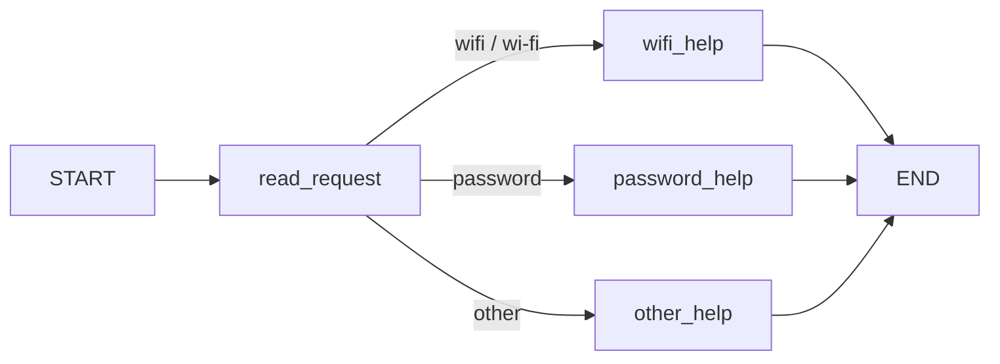
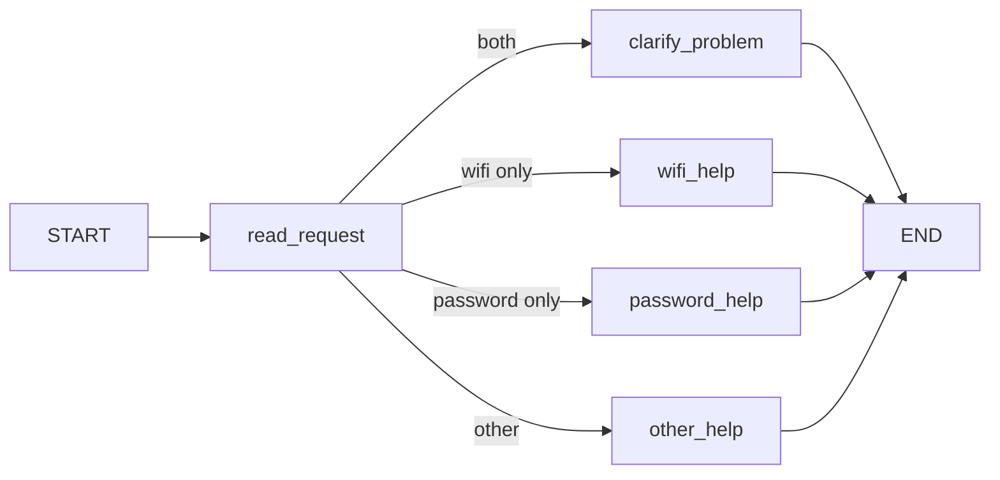
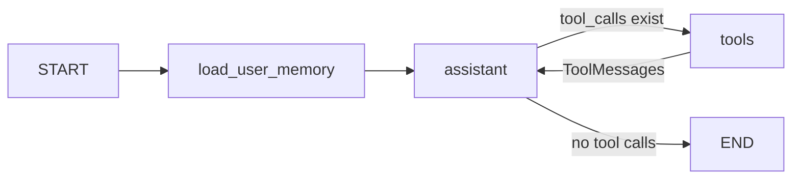

# HW5 — My LangGraph helpdesk

**Course:** CSS4007 Artificial Intelligence  
**Python used for this generated report:** 3.13.18 (run `python --version` in Colab to confirm)  
**Provider:** OpenAI for real runs / labelled fake model for offline tests  
**Model:** gpt-4o-mini  
**Recorded scenarios:** 14/14; automatic checks passed: 14/14.

The scenarios in this report were run with OpenAI for Parts 2-3.

## Part 1 — How the graph works

### My original graph and state

The state includes `message`, `category`, and `reply`. `read_request` reads `message` and writes `category`. Each help node reads the category or message as needed, retrieves the corresponding local guide, and writes `reply`. The conditional edge reads `category` and chooses a next node; unlike a node, it does not produce a state update. Every node receives the current accumulated state, not just the previous node's delta. `START` is the entry marker, `END` is the finish marker, and compiling produces a runnable graph from nodes and edges.

### Predictions made before running

| Message | Predicted route | Actual route | Conclusion |
| --- | --- | --- | --- |
| I cannot connect to Wi-Fi. | START → read_request → wifi_help → END | START → read_request → wifi_help → END | Matches prediction |
| I forgot my PASSWORD. | START → read_request → password_help → END | START → read_request → password_help → END | Matches prediction |
| My laptop screen is broken. | START → read_request → other_help → END | START → read_request → other_help → END | Matches prediction |
| My Wi-Fi password does not work. | START → read_request → wifi_help → END | START → read_request → wifi_help → END | Matches prediction |

The original rule checks Wi-Fi first, so the message that contains both 'Wi-Fi' and 'password' follows the Wi-Fi node.

### Modified graph with clarification

Observed S05 route: **START → read_request → clarify_problem → END**.

The new `clarify_problem` node is reached only when both topic keywords appear. LangGraph controls node execution and state propagation; my Python routing function decides the category and my Python help functions decide the response content. No LLM runs in Part 1.

## Part 2 — Model chooses tools

The `assistant` node calls a bound tool-capable model. Its tool calls determine the conditional edge to `tools`. The `ToolNode` executes the corresponding Python tool and adds `ToolMessage` results to the accumulated conversation. The agent node sees those results on the next loop, then chooses whether to make another tool call or provide a final answer. This differs from fixed keyword routing because the model chooses actions based on the conversation and observed tool results, while Python still enforces the conditional ticket rule. The `assistant` node enforces a maximum of **6 model rounds per user message**; graph recursion is separately capped at 24.

All three tools also work as standalone Python functions via `python -m helpdesk.cli direct-tools --profile normal`. `find_instructions` reads `data/helpdesk.json`; `check_service_status` reads `data/service_status.json`; `prepare_ticket` validates user-stated steps and writes a JSON draft using `data/ticket_template.json`. No tickets are submitted.

### Actual snapshots and tool-use observations

- **S06** (`normal`): observed tool results: find_instructions, check_service_status, prepare_ticket; tickets created: 1. Full trace: `outputs/S06.json`.
- **S07** (`wifi_outage`): observed tool results: check_service_status; tickets created: 0. Full trace: `outputs/S07.json`.
- **S08** (`status_unavailable`): observed tool results: check_service_status; tickets created: 0. Full trace: `outputs/S08.json`.
- **S14** (`recovery_outage`): observed tool results: check_service_status; tickets created: 0. Full trace: `outputs/S14.json`.

See the logs for model messages, tool arguments, tool results, final answers and ticket filenames. A Wi-Fi outage or unknown status must not satisfy the user's 'only if operating' condition. `account_recovery` is checked for password recovery problems.

## Part 3 — Conversation and user memory

The LangGraph `SqliteSaver` stores the accumulated messages separately for each `(user_id, thread_id)` pair in `local-storage/.../checkpoints.sqlite`. The identifier `thread_id` refers to one conversation, while `user_id` identifies the fictional user across multiple conversations. A separate SQLite table `user_preferences` in `preferences.sqlite` saves only an explicitly requested language preference keyed by `user_id`. Language is never initialized from `demo_users.json`.

On every turn the `load_user_memory` node reads preferences. User messages from the same thread remain available after a new OS process opens the same checkpoint database. The program actually launches separate child processes at `restart_process` events; the logs include their distinct PIDs and commands.

| Situation | Command | Log file | What actually happened |
| --- | --- | --- | --- |
| Current thread reference | `python -m helpdesk.cli run-scenarios --mode real --ids S10` | `outputs/S10.json` | Result=PASS; saved language=not set; prior messages in this thread=4 |
| Close process and restart | `python -m helpdesk.cli run-scenarios --mode real --ids S11` | `outputs/S11.json` | Result=PASS; saved language=Kazakh; prior messages in this thread=4; process PIDs=[27695, 27726] |
| Same user, a new thread | `python -m helpdesk.cli run-scenarios --mode real --ids S12` | `outputs/S12.json` | Result=PASS; saved language=Kazakh; prior messages in this thread=0; process PIDs=[26911, 26936] |
| Different user | `python -m helpdesk.cli run-scenarios --mode real --ids S13` | `outputs/S13.json` | Result=PASS; saved language=not set; prior messages in this thread=0 |

Looking up troubleshooting steps in `helpdesk.json` is **retrieval** from an external reference file. Remembering the user's preference is **user memory** persisted by user ID; conversation messages are **thread memory** persisted by the checkpointer. Neither reference retrieval nor user memory is supplied by another user's conversation.

### Literal reference: `I already tried that`

First prompt: I cannot connect to Wi-Fi. Find the local Wi-Fi instructions and recommend only the first step.

First reply: To connect to the Wi-Fi, the first step is to **check that Wi-Fi is enabled and airplane mode is off**.

Literal follow-up: I already tried that.

Actual follow-up reply: Which step did you try after checking that Wi-Fi is enabled and airplane mode is off?

Prior checkpoint messages: 4. Source: LangGraph SQLite thread memory; guide lookup: `data/helpdesk.json` (retrieval); language preference: `preferences.sqlite` (user memory). Raw evidence: `outputs/EXTRA_MEMORY_REFERENCE.json`.

## Part 4 — Reproduction, tests and CI

Install exact package versions using `pip install -r requirements.txt`. Set the model key in an ignored `.env` or `OPENAI_API_KEY` environment variable, and choose a tool-capable `MODEL_NAME`. Run `python -m helpdesk.cli run-scenarios --mode real`. Run `python -m pytest -q` for **API-free tests** with an explicitly fake model. GitHub Actions runs the same tests on each push and pull request. Memory and drafts are in ignored `local-storage/`; remove the directory to reset them, while `outputs/*.json` contains fictional shareable traces. Full commands are in `README.md`.

Tests catch: Part 1 routing / case sensitivity / changed graph; incorrect guide or status lookup; missing ticket details; violation of conditional ticket policy; broken persistent preference and checkpoint reload; mixing two users or threads. The fake-model tests prove graph wiring only, not real LLM accuracy.

## Choices and limitations

SQLite is simple and persistent across real process restarts, suitable for a small single-user demo. `SqliteSaver` is not a production high-concurrency database. The fake tool model has no intelligence and its outputs must not be represented as real LLM calls. The real model may vary wording or choose extra tools; review every real trace. A conservative deterministic pattern recognizer accepts explicitly reported troubleshooting steps for the supplied exercises but does not understand all paraphrases. Service status and tickets are fictional, not university systems. Google Colab temporary runtime storage is lost if its runtime resets unless this project is saved to Google Drive.

## Supplied scenarios — actual results

Run all fourteen: `python -m helpdesk.cli run-scenarios --mode real`, and regenerate this file: `python -m helpdesk.cli report --mode real`.

| Scenario | Runner command suffix | Log file | Observed result / review |
| --- | --- | --- | --- |
| S01 — Simple Wi-Fi route | `--ids S01` | `outputs/S01.json` | PASS; GUIDE-WIFI: Check that Wi-Fi is enabled and airplane mode is off. Select th |
| S02 — Case-insensitive password route | `--ids S02` | `outputs/S02.json` | PASS; GUIDE-PASSWORD: Open the practice sign-in screen and choose Forgot password |
| S03 — Unsupported request | `--ids S03` | `outputs/S03.json` | PASS; Is your question about Wi-Fi or a password? |
| S04 — Two topics before the graph change | `--ids S04` | `outputs/S04.json` | PASS; GUIDE-WIFI: Check that Wi-Fi is enabled and airplane mode is off. Select th |
| S05 — Two topics after adding clarification | `--ids S05` | `outputs/S05.json` | PASS; Is the issue connecting to Wi-Fi, or recovering an account password? Which  |
| S06 — Instructions then local ticket | `--ids S06` | `outputs/S06.json` | PASS; Here are the Wi-Fi troubleshooting steps:  1. Check that Wi-Fi is enabled a / The Wi-Fi service is operational, and I have prepared a ticket draft regard |
| S07 — The same request during a Wi-Fi outage | `--ids S07` | `outputs/S07.json` | PASS; The demo Wi-Fi service is currently experiencing an outage across campus, a |
| S08 — Status source unavailable | `--ids S08` | `outputs/S08.json` | PASS; The Wi-Fi status is currently unknown, meaning neither an outage nor operat |
| S09 — Missing ticket details | `--ids S09` | `outputs/S09.json` | PASS; Could you please provide the details of the problem you're experiencing and / I've created a draft for your support ticket regarding the Wi-Fi issue. Her |
| S10 — Use the current conversation | `--ids S10` | `outputs/S10.json` | PASS; The demo Wi-Fi service is currently operational, with no reported outages.  / You mentioned that you enabled Wi-Fi and forgot the saved network, but reco |
| S11 — Persist and recall after restart | `--ids S11` | `outputs/S11.json` | PASS; Wi-Fi қызметінің статусы: жұмыс істеп тұр. Яғни, ешқандай ақау туралы хабар / Біз Wi-Fi мәселесін талқыладық. Сіз Wi-Fi-ды қосып, қайта қосылуға тырысқан |
| S12 — Preference across threads without replay | `--ids S12` | `outputs/S12.json` | PASS; Сіздің тілдік таңдауыңызды ескеремін: жауаптар қазақ тілінде болады. Wi-Fi  / Сіз мені қазақ тілінде жауап беруімді сұрадыңыз. Мен Wi-Fi, парольді қалпын |
| S13 — Do not share memory between users | `--ids S13` | `outputs/S13.json` | PASS; Сіздің тілдік таңдауыңызды ескеремін: жауаптар қазақ тілінде болады. Wi-Fi  / You haven't mentioned a preferred language or reported a previous problem i |
| S14 — Password recovery outage | `--ids S14` | `outputs/S14.json` | PASS; The password recovery service is currently experiencing an outage and is un |

## AI tool disclosure

I used ChatGPT to help understand the assignment and draft the implementation and documentation. Actual execution results are saved separately in the program logs.
